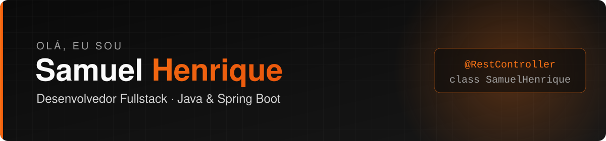

  

  
  
  

---

## Sobre mim

Desenvolvedor Fullstack com base sólida em arquitetura de software e código limpo. Atuo de ponta a ponta — do back-end ao front-end, do banco de dados à infraestrutura — transformando necessidades de negócio em software robusto, escalável e fácil de manter.

- **Atualmente:** Desenvolvedor Fullstack na **VGX Contact Center**, trabalhando com **Java e Spring Boot**
- **Foco:** APIs REST, Arquitetura Limpa/Hexagonal, mensageria e código testável
- **Front-end:** interfaces modernas com React, Next.js e TypeScript
- **Localização:** Betim, MG — aberto a trabalho remoto

---

## Stack

<table>
  <tr>
    <td><b>Back-end</b></td>
    <td></td>
  </tr>
  <tr>
    <td><b>Front-end</b></td>
    <td></td>
  </tr>
  <tr>
    <td><b>Dados</b></td>
    <td></td>
  </tr>
  <tr>
    <td><b>Infra & Ferramentas</b></td>
    <td></td>
  </tr>
</table>

---

Feito com ☕ e Java por Samuel Henrique

